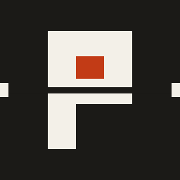

# percival-server

The panel for [Percival](https://github.com/RijinRaju/percival), a
self-hosted control panel for Celery. It provides the web UI and API for
managing RedBeat schedules, run history, worker versions and the audit log.

Your Celery project needs the [`percival`](https://pypi.org/project/percival/)
client too.

## Run it

The easiest way is the Docker image, which has the UI built in:

```
docker run -d -p 8080:8080 -v percival:/data \
  -e PERCIVAL_REDIS_URL=redis://redis:6379/0 \
  -e PERCIVAL_ADMIN_PASSWORD=pick-a-long-one \
  ghcr.io/rijinraju/percival
```

Or from PyPI:

```
pip install percival-server
PERCIVAL_REDIS_URL=redis://localhost:6379/0 PERCIVAL_ADMIN_PASSWORD=pick-a-long-one percival-server
```

Then open http://localhost:8080 and log in as `admin`.

| env | default | |
|---|---|---|
| `PERCIVAL_REDIS_URL` | none | where RedBeat and the client keep their keys |
| `PERCIVAL_BROKER_URL` | the Redis URL | set it when the broker isn't Redis (`CELERY_BROKER_URL` works too) |
| `PERCIVAL_ADMIN_USERNAME` / `PERCIVAL_ADMIN_PASSWORD` | `admin` / none | creates the first admin if nobody exists yet |
| `PERCIVAL_SECRET_KEY` | generated into the data dir | |
| `PERCIVAL_DATA_DIR` | `./data` | SQLite database and the generated key |
| `PERCIVAL_DATABASE_URL` | SQLite in the data dir | Postgres works too |
| `PERCIVAL_HOST` / `PERCIVAL_PORT` | `127.0.0.1` / `8080` | |
| `PERCIVAL_SECURE_COOKIES` | on | turn it off only for plain http on localhost |

Every setting is optional. If you leave out the URLs or the admin, the first
visit asks for them.

Put the panel behind a reverse proxy with TLS if anyone besides you will use
it. The [full README](https://github.com/RijinRaju/percival#readme) has the
rest.
